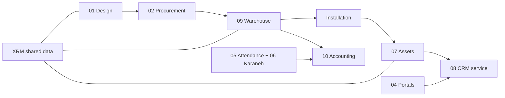

# Software ecosystem | اکوسیستم نرم‌افزاری هم‌آوا ولتاژ

[← Organization profile](../../profile/README.md) · [Products explained](products.md) · [Repository map](repository-map.md)

> **Source & scope:** Adapted from the user-provided 2026 *Hamava Voltage Software Ecosystem Catalog* (13 pages). This is the **intended product architecture** of one XRM-centered ecosystem. It is not a declaration that all modules or integrations are implemented or live.

## The idea in one minute | ایده در یک دقیقه

A building is designed, purchased, constructed, used and serviced over many years. Information often gets copied and lost between those stages. The catalog proposes **one shared core, XRM**, so that people, projects, documents, products and assets do not need to be re-entered in every tool.

**مثال قابل لمس:** پروژه‌ای را تصور کنید که نقشه شبکه فیبر آن طراحی می‌شود. اقلام لازم وارد فرایند خرید می‌شوند. پس از تحویل کالا، تیم اجرا وظایف و گزارش خود را ثبت می‌کند. تجهیزات نصب‌شده شناسنامه اموال می‌گیرند و درخواست سرویس بعدی به تیکت تبدیل می‌شود. همه این‌ها **سناریوی هدف کاتالوگ** است.

## 12 modules — with real-world meaning

| Module | Who needs it? | What the person does | Data in → Useful result out |
| --- | --- | --- | --- |
| **01 Hamava Design** | Engineer / design team | Draw building and ELV/GPON systems, coordinate changes, work with quantities | Project + technical design → drawings, revisions, target BOM |
| **02 Tondar / Tamin** | Purchasing / supplier | Request prices, assess suppliers, compare offers | BOM + budget → approved sourcing and purchase order |
| **03 Furnish** | Cabinet designer / workshop / customer | Configure cabinets, review layouts and material selections | Room + design choices → preview, material/cut list, quote concept |
| **04 Interactive Portals** | Staff / manager / owner / customer | View tasks, approvals, progress and relevant records | Shared XRM data → role-specific dashboards |
| **05 Attendance** | Employee / HR | Clock in/out, manage shifts and leave | Staff + site + time → attendance and payroll inputs |
| **06 Karaneh** | Staff / manager | Assign work, record reports, review quality and timeliness | Tasks + approved work → KPI and performance-bonus calculations |
| **07 Assets** | Inventory / facilities team | Register equipment, assign holders, record maintenance and transfer | Installed devices + assignments → asset register and service history |
| **08 CRM & Automation** | Sales / customer care | Track leads, tickets, contracts and approval flows | Enquiries + service events → follow-ups, tickets and tasks |
| **09 Warehouse** | Stores / site supervisor | Receive, reserve, transfer and count items | Purchase order + project BOM → tracked stock movement |
| **10 Accounting** | Finance / management | Record transactions, costs, wages and project budgets | Purchases + invoices + payroll → project financial views |
| **11 Mail Server** | Everyone in the organization | Communicate on organizational mail accounts | Users + messages → retained business correspondence |
| **12 Chat & Video** | Project teams / owners | Discuss work, meet and share controlled files | Projects + staff → collaboration records and actionable requests |

These are condensed **catalog descriptions**, not feature-completion statements. The original catalog also describes security, API integration, approval workflows, event bus, audit trail, backup and phased rollout as cross-platform goals.

## XRM is the connective idea, not a magic switch

The catalog defines XRM (Extended Relationship Management) as a shared model for **contacts, organizations, projects, buildings, spaces, items, assets, tasks, tickets, documents and roles**. It anticipates SSO, workflow rules, an API gateway, event delivery, reporting and audit history.

**Important distinction:** The privately developed **XRM-ME** engineering application has its own medical/technical-service scope, code and release path. A catalog-wide XRM vision does not prove XRM-ME has implemented the entire twelve-module building suite.

## How a project flows — example, not a live demonstration

1. **Design:** An engineer places fiber/lighting equipment and prepares a bill of materials.
2. **Purchase:** Purchasing asks approved vendors for quotes and evaluates responses.
3. **Receive:** Warehouse records delivery and assigns stock to the project.
4. **Install:** Staff receive work assignments, log attendance and file reports.
5. **Register assets:** Installed equipment receives an asset record with an assigned owner/location.
6. **Maintain:** A fault or service date becomes a customer-care ticket.
7. **Analyze:** Managers review progress, cost, quality, outstanding work and service records.

This narrative helps non-technical buyers understand the goal; delivery status must be verified **module by module** before sales or portfolio publication.

## Scope outside the twelve modules

**HamDirect** is a separate Instagram engagement automation product. **VISISTECH** is a specialized network-equipment commerce product. **Hamava Support**, **VISIS Platform**, **ShenavaPlus** and **Hamava Sakht** have separate codebases and business stories; do not relabel them as extra XRM modules or automatically assume they are integrated.

[Explore these independent products →](products.md)

## Responsible publication

- Do not expose non-public architecture, server addresses, tokens, customer details or screenshots of operational records.
- Clearly mark a system as **vision, source-reviewed, under review or release-verified**.
- A planned connection from module A to B is **not** an implemented API integration.
- Real business metrics and customer outcomes require evidence.

*Source: Hamava Voltage Software Ecosystem Catalog, pages 1–12, supplied for this portfolio initiative; condensed for clarity, not independently audited implementation evidence.*
