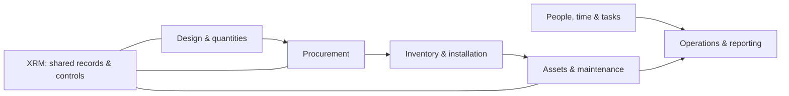

# HAMAVA VOLTAGE | هم‌آوا ولتاژ
### Engineering the full journey — from building design to operation
**از طراحی ساختمان تا اجرا، خدمات و نگهداشت؛ با نرم‌افزار، اتوماسیون و زیرساخت مهندسی‌شده**

[Website](https://hamavaelv.ir) · [Explore our projects](#explore-the-products) · [Public engineering case studies](#public-case-studies) · [Contact](mailto:info@hamavaelv.ir)

---

## What do we actually do? | ما چه کار می‌کنیم؟

We build **real-world business software and connected engineering systems**, particularly for construction, electrical / ELV infrastructure, technical services and team operations. Our work connects the interfaces people use with the APIs, workflows, security and infrastructure that make those interfaces reliable.

**به زبان ساده:** به‌جای اینکه هر واحد سازمان با فایل اکسل، پیام‌رسان و نرم‌افزار جدا کار کند، محصولات و یکپارچه‌سازی‌هایی طراحی می‌کنیم که اطلاعات، فرایندها و افراد را به هم وصل کنند.

**A tangible example:** Someone designs a building network → the materials are listed → purchasing and stock teams track those materials → installation work is assigned → equipment becomes a managed asset → the owner can request maintenance. This is our **end-to-end ecosystem vision**, not a claim that all integrations are already live.

## Explore the products | محصولات ما

These are **distinct products and engineering workstreams** — not 20 versions of one application. Private source stays private; the descriptions below are intended to make the business value understandable.

| Product | What it solves — in plain English | Read the story |
| --- | --- | --- |
| **Hamava Design · هم‌آوا دیزاین** | Connect building and ELV design decisions to quantities and downstream project work | [Design vision & scope](docs/portfolio/products.md#hamava-design) |
| **Furnish · هم‌آوا فرنیش** | Help cabinet/interior teams organize design, material choices, preview and customer approvals | [Furnish explained](docs/portfolio/products.md#furnish) |
| **XRM / XRM-ME** | Connect organizations, customer relationships, assets, work and permissions instead of juggling disconnected records | [XRM explained](docs/portfolio/products.md#xrm-and-xrm-me) |
| **HamDirect · همدایرکت** | Design Instagram comment-to-message engagement rules with page access controls and safe previews | [HamDirect explained](docs/portfolio/products.md#hamdirect) |
| **VISISTECH** | Make technical network and ELV product discovery and purchasing clearer | [Commerce explained](docs/portfolio/products.md#visistech-commerce) |
| **HamavaYar · هم‌آوا یار** | Support employee attendance, tasks, work reports and performance workflows | [Workforce explained](docs/portfolio/products.md#hamavayar-workforce) |
| **Hamava Support** | Give customers a support portal while keeping operational tickets connected to CRM | [Support case study](https://github.com/HamavaELV/customer-support-crm-case-study) |
| **VISIS Platform** | Connect ELV consultation and customer journeys with engineering network mapping | [Engineering case study](https://github.com/HamavaELV/elv-platform-network-mapping-case-study) |
| **ShenavaPlus** | Explore digital experiences for swimming classes and coaching | [Project status](docs/portfolio/products.md#shenavaplus) |
| **Hamava Sakht** | A construction-operation platform workstream | [Project status](docs/portfolio/products.md#hamava-sakht) |

**Behind the scenes:** Our private repositories also include integration services, workflow infrastructure and component-specific codebases. Repository visibility is **not** the same as whether a product is available to customers.

## One shared product direction — 12 modules, XRM at the center

Our 2026 *Software Ecosystem Catalog* describes twelve specialized modules organized around a shared XRM model, spanning **design, procurement, construction, back office, collaboration and maintenance**. These modules are a **product architecture/roadmap**, not a list of twelve independently verified production releases.

[See all 12 modules, their users, inputs and outputs](docs/portfolio/ecosystem.md)

## Public case studies | نمونه‌کارهای قابل مشاهده

You don't need access to our private code to understand selected engineering work. Start here:

| Case study | The actual user journey | Technology & decisions |
| --- | --- | --- |
| [Secure field attendance](https://github.com/HamavaELV/hamavayar-attendance-case-study) | Employee checks in via Telegram, fresh GPS/geofence and live selfie | Next.js, FastAPI, PostgreSQL; identity, auditing, resilient events |
| [Customer support + CRM](https://github.com/HamavaELV/customer-support-crm-case-study) | Customer submits a ticket and the service team handles it in connected workflows | Django, React, PostgreSQL, background jobs and CRM synchronization |
| [ELV engineering + network mapping](https://github.com/HamavaELV/elv-platform-network-mapping-case-study) | Customer requests technical work; an engineering team maps equipment and quantities | Next.js, Django, Supabase; project access and BOQ |
| [Persian corporate web](https://github.com/HamavaELV/persian-rtl-corporate-web-case-study) | Visitor understands ELV services, explores content and requests a consultation | React, TypeScript, Vite; RTL, forms, accessibility and deployment |

These are **sanitized case studies**. They intentionally omit customer data, credentials and private implementation.

## How we engineer | روش کار

1. **Understand the workflow:** map the actual people, decisions and data involved.
2. **Make it understandable:** design Persian-first, mobile-friendly interfaces and clear permissions.
3. **Build reliable boundaries:** structured APIs, database models, integrations and auditable changes.
4. **Verify before shipping:** tests, controlled migrations, code review and environment-specific checks.
5. **Operate responsibly:** monitored services, safe releases, recoverability and ongoing improvements.

**Common technologies (vary by product):** Python · Django · FastAPI · Next.js · React · TypeScript · PostgreSQL · Redis · Docker · Linux · Keycloak/OIDC · n8n · CRM integrations.

## Delivery transparency

We deliberately distinguish:

- **Vision / Planned** — what the catalog proposes.
- **In development / Review** — working code or documentation still under verification.
- **Verified in source** — functionality evidenced in a repository.
- **Released / Live** — requires independent deployment and acceptance evidence.

No roadmap item is automatically a shipped feature. See [portfolio status and repository map](docs/portfolio/repository-map.md) for exact code locations and review notes.

## Work with us | همکاری با هم‌آوا

If your business operates physical infrastructure, field teams, customer service or complex approvals, we can help turn disconnected workflows into maintainable software.

**Website:** [hamavaelv.ir](https://hamavaelv.ir) · **General:** [info@hamavaelv.ir](mailto:info@hamavaelv.ir) · **Support:** [support@hamavaelv.ir](mailto:support@hamavaelv.ir)

Hamava Voltage · Updated October 2026 · Product descriptions are scoped to reviewed evidence and the supplied ecosystem catalog. Public documentation contains no production secrets.
